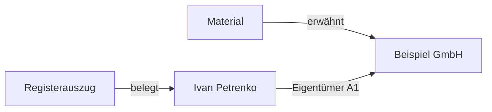

# Wissensverknüpfungen und Graph — Prinzipien und Regeln

[🇺🇦 Українська](KNOWLEDGE_GRAPH.uk.md) · [🇬🇧 English](KNOWLEDGE_GRAPH.en.md) · [🇫🇷 Français](KNOWLEDGE_GRAPH.fr.md) · **🇩🇪 Deutsch** · [🇪🇸 Español](KNOWLEDGE_GRAPH.es.md) · [🇰🇷 한국어](KNOWLEDGE_GRAPH.ko.md) · [🇯🇵 日本語](KNOWLEDGE_GRAPH.ja.md)

> Gilt für MD Notes v0.3.23. Der ukrainische Text ist kanonisch. Dieses Dokument beschreibt das tatsächliche Datenmodell und das aktuelle Verhalten; die optische Position eines Knotens ist kein Wissensinhalt.

## 1. Grundprinzip

In MD Notes sind **die Notizen die Quelle der Wahrheit**. Der Graph ist nur eine Darstellung.

- Knoten = Notiz;
- normale Kante = aufgelöster Wiki-Link;
- typisierte Relation = expliziter strukturierter Fakt im YAML-Front-Matter;
- der SQLite-Index in `.mdnotes/cache` ist ein neu erzeugbarer Cache;
- Position, Farbe, Form und Linienlänge verändern die Daten nicht.

Der Graph kann aus Markdown neu aufgebaut werden.

## 2. Vier Strukturmechanismen

| Mechanismus | Zweck |
|---|---|
| Ordner | physische Gruppierung |
| `[[Wiki-Links]]` | freie semantische Verknüpfungen |
| Tags | thematische Querstruktur |
| Eigenschaften/Front Matter | maschinenlesbare Fakten, Typen und Relationen |

Ein gemeinsamer Ordner oder Tag erzeugt keine Kante. Kanten entstehen durch Links oder explizite `relations`.

## 3. Normale Wiki-Links

```markdown
Das Unternehmen wird von [[Iryna Fediura]] geführt.
Siehe auch [[Beispiel GmbH|Firmenkarte]].
```

Ein aufgelöster Link bedeutet: `aktuelle Notiz ───► Zielnotiz`.

Doppelte identische Links erzeugen keine doppelten Kanten. Selbstlinks werden nicht als eigene Kante gezeigt. Eine nicht auflösbare Zielangabe darf keinen erfundenen Knoten oder Fakt erzeugen.

Ein Wiki-Link sagt nur: **„Diese Notiz verweist auf jene Notiz.“**

## 4. Typisierte Relationen

Für Fakten mit Richtung, Typ, Quelle oder Zuverlässigkeit:

```yaml
---
title: Ivan Petrenko
type: person
relations:
  - to: "Beispiel GmbH"
    type: "Eigentümer"
    grade: "A1"
    origin: "Unternehmensregister"
    status: "confirmed"
    evidence: "Registerauszug vom 2026-10-30"
---
```

Lesart: **Ivan Petrenko → Eigentümer → Beispiel GmbH**.

| Feld | Pflicht | Bedeutung |
|---|---|---|
| `to` | ja | Zielnotiz, wie interner Link aufgelöst |
| `type` | nein | Semantik der Relation |
| `grade` | nein | Zuverlässigkeit, Buchstabe + Ziffer |
| `origin` | nein | Herkunft des Fakts |
| `status` | nein | Prüf-/Lebenszyklusstatus |
| `evidence` | nein | konkrete Beleggrundlage |
| `dir` | nein | `in` kehrt die Richtung um; sonst von der haltenden Notiz zu `to` |

Nicht aufgelöste Ziele werden nicht zu Graph-Fakten. Selbstrelationen werden ignoriert. Fehlende optionale Felder dürfen nicht erfunden werden.

### Umgekehrte Richtung

Liegt in „Beispiel GmbH“ eine Relation mit `to: "Ivan Petrenko"` und `dir: in`, lautet die Graphrichtung **Ivan Petrenko → Beispiel GmbH**.

## 5. A1–F6

- Buchstabe **A–F**: Bewertung der Quelle;
- Ziffer **1–6**: Bewertung der Aussage;
- **A1** stärkste, **F6** schwächste Kombination.

MD Notes entscheidet Wahrheit nicht automatisch. Ein Grade braucht eine Grundlage.

Für die schnelle Ansicht gruppiert die Oberfläche vor allem die Ziffer: 1–2 zuverlässig, 3–4 mittel, 5–6 schwach/**GERÜCHT**, ohne `grade` = nicht formal bewertet. Farbe ist nie das einzige Signal.

## 6. Globaler und lokaler Graph

Der **globale Graph** enthält alle indexierten Notizen, aufgelöste Wiki-Links und typisierte Relationen zwischen bekannten Knoten. Eine isolierte Notiz darf ohne Kante erscheinen.

In v0.3.23 zeigt der **lokale Graph** die aktive Notiz plus eine **Ein-Hop-Nachbarschaft** aus aufgelösten normalen Links.

Aktuelle Grenze: Eine typisierte Relation allein erweitert den lokalen Snapshot nicht. Sie wird eingeblendet, wenn beide Endpunkte bereits sichtbar sind.

## 7. Relationsbaum und Ketten

Der Relationsbaum ist gerichtet und startet an einer Wurzel.

- `grade` zum Elternknoten = beste Bewertung der Linien zwischen diesem Paar;
- `pathGrade` = **schwächste Bewertung im gesamten Pfad** von der Wurzel.

Eine Kette ist also nicht zuverlässiger als ihr schwächstes Glied. Ein gefundener Pfad hilft bei Navigation/Analyse und beweist für sich allein weder Kausalität noch Eigentum.

## 8. Darstellung ist nicht Bedeutung

Schwebende Physik, Kräfte, Abstoßung, Linklänge, Zoom und Ziehen dienen nur der Lesbarkeit. Formen können Notiztypen, Farben Bewertungen zeigen. Sie erzeugen keine Fakten.

## 9. Empfohlene Praxis

1. Für wichtige wiederverwendbare Entitäten eigene Notizen anlegen.
2. `[[Link]]` für normale Erwähnungen.
3. `relations` für Fakten mit Typ, Richtung oder Beleg.
4. Kein `grade` ohne Grundlage.
5. Wichtige Relationen mit `origin` und `evidence` versehen.
6. Den gleichen Fakt nicht unnötig in beiden Richtungen duplizieren; kanonischen Eintrag und `dir` verwenden.
7. Nach Massenimport ungelöste Ziele prüfen.
8. Aus optischer Nähe keine Semantik ableiten.

## 10. Beispiel



Primärdaten bleiben in Markdown/Front Matter. Ändert sich der Beleg, werden Relation bzw. `evidence/status/grade` geändert.

## 11. Was der Graph nicht beweist

Ohne explizite Fakten darf ein gemeinsamer Nachbar nicht als gemeinsamer Eigentümer interpretiert werden; ein Wiki-Link ist keine juristische/kausale Richtung; ein roter Knoten ist nicht automatisch „falsch“; eine fehlende Kante beweist keine fehlende reale Beziehung.

Der Graph zeigt **aufgezeichnete und aufgelöste Informationen**.

## 12. Automatisierung und KI

Normative Agentenregeln:
- [GRAPH_CONTRACT.md](../ai/GRAPH_CONTRACT.md);
- [graph-contract.yaml](../ai/graph-contract.yaml).

Eine KI darf Relation, `grade`, `origin` oder `evidence` nicht ohne stützende Daten erfinden.

> Automatisch erzeugte, nicht muttersprachlich geprüfte Übersetzung; der ukrainische Text ist kanonisch.
