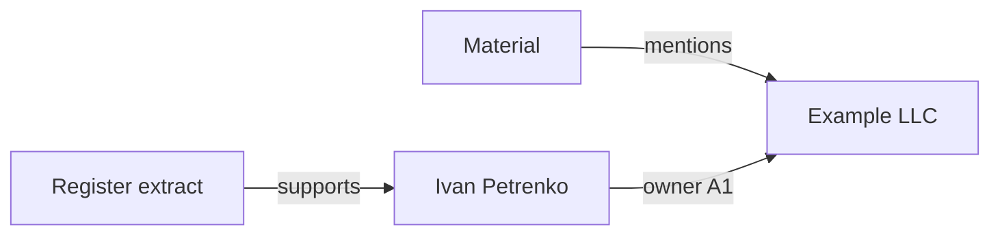

# Knowledge links and graph — principles and rules

[🇺🇦 Українська](KNOWLEDGE_GRAPH.uk.md) · **🇬🇧 English** · [🇫🇷 Français](KNOWLEDGE_GRAPH.fr.md) · [🇩🇪 Deutsch](KNOWLEDGE_GRAPH.de.md) · [🇪🇸 Español](KNOWLEDGE_GRAPH.es.md) · [🇰🇷 한국어](KNOWLEDGE_GRAPH.ko.md) · [🇯🇵 日本語](KNOWLEDGE_GRAPH.ja.md)

> Applies to MD Notes v1.0.0. The Ukrainian document is canonical. This translation explains the actual data model and current product behavior; visual node placement is not part of the knowledge itself.

## 1. Core principle

In MD Notes, **notes are the source of truth** and the graph is a view of them.

- node = note;
- ordinary edge = a resolved wiki link from one note to another;
- typed relation = an explicit structured fact in YAML front matter;
- the SQLite index in `.mdnotes/cache` is a rebuildable cache, not a separate knowledge store;
- node position, colour, shape and line length do not change the underlying data.

The graph can therefore be rebuilt from Markdown. Do not edit a “graph picture” instead of the notes that define it.

## 2. Four different structure mechanisms

| Mechanism | Purpose |
|---|---|
| folders | physical grouping: where a file lives |
| `[[wiki links]]` | free semantic links between notes |
| tags | cross-cutting topics and classification |
| properties/front matter | machine-readable facts, types and typed relations |

A folder does not automatically create a graph relation. Sharing a tag does not create an edge either. An edge comes from a link or an explicit `relations` entry.

## 3. Ordinary wiki links

```markdown
The company is managed by [[Iryna Fediura]].

See also [[Example LLC|company card]].
```

After indexing, a resolved link creates the direction:

```text
current note  ───►  target note
```

Repeated identical links do not produce duplicate edges. A self-link is not shown as a separate edge. If a target cannot be resolved to an existing note, the graph must not invent a node or a fact.

A wiki link means only **“this note links to that note.”** It does not define the exact relationship or its reliability.

## 4. Typed relations

Use the `relations` list when a fact needs a direction, type, source or confidence assessment:

```yaml
---
title: Ivan Petrenko
type: person
relations:
  - to: "Example LLC"
    type: "owner"
    grade: "A1"
    origin: "company register"
    status: "confirmed"
    evidence: "Register extract dated 2026-10-30"
---
```

Human reading: **Ivan Petrenko → owner → Example LLC**, based on the register and a specific extract.

| Field | Required | Meaning |
|---|---|---|
| `to` | yes | target note; resolved like an internal link |
| `type` | no | semantics such as owner, manager, participant, mentions, source |
| `grade` | no | reliability grade, letter + digit, for example `A1` |
| `origin` | no | where the fact came from |
| `status` | no | verification or lifecycle status |
| `evidence` | no | concrete supporting document, quote or evidence reference |
| `dir` | no | `in` reverses the direction; otherwise the relation goes from the note holding the entry to `to` |

If `to` does not resolve, the relation is not turned into a graph fact. Self-relations are ignored. Missing optional fields must not be inferred.

### Reverse direction

```yaml
relations:
  - to: "Ivan Petrenko"
    type: "owned by"
    dir: "in"
    grade: "A1"
```

If this entry is stored in “Example LLC”, `dir: in` makes the graph direction **Ivan Petrenko → Example LLC**.

## 5. A1–F6 grades

A grade has two parts:

- **A–F letter** — assessment of the source;
- **1–6 digit** — assessment of the claim;
- **A1** is the strongest combination and **F6** the weakest.

MD Notes does not determine truth automatically. A grade is supplied by a person or a controlled import/analysis process that has evidence for it.

For quick visual reading the UI primarily groups the numeric part:
- 1–2 — reliable;
- 3–4 — medium;
- 5–6 — weak and marked **“RUMOUR”**;
- no `grade` — no formal assessment.

Colour is only an aid; the textual grade and markers remain the authoritative signal.

## 6. Global and local graph construction

### Global graph

The global graph includes every indexed note as a node, collects resolved outgoing/incoming wiki links, and overlays typed relations between known nodes.

An isolated note may appear with no edges.

### Local graph

In v1.0.0 the local graph contains the active note plus a **one-hop neighbourhood** formed by resolved ordinary links.

Current implementation boundary: a typed relation by itself does not expand that local snapshot. It is displayed only when both endpoints are already among the visible nodes. This is rarely limiting in the global graph because all indexed notes are present there.

## 7. Relation tree and chains

The relation tree is directional and starts from a selected root.

For each parent-child step:
- the node `grade` is the best grade among lines connecting that pair;
- `pathGrade` is the **weakest grade on the entire path** from the root.

The principle is: a chain is not more reliable than its weakest link. A strong relation followed by a weak one must not be averaged into a falsely strong conclusion.

Finding a path between two notes is a navigation/analysis tool. The existence of a path alone does not prove causality, ownership or any semantics not explicitly recorded in relation types.

## 8. Presentation is not meaning

Floating physics, force controls, repulsion, link length, zoom and dragging exist for readability only.

Shapes may represent note types. Colours and line styles may represent grades. None of these create facts.

A layout may look different after restart while the semantic graph remains exactly the same.

## 9. Recommended practice

1. Create a reusable note for an entity such as a person, company, document or event.
2. Use a `[[link]]` for an ordinary mention.
3. Use `relations` when the fact needs “who/what/to whom/on what evidence”.
4. Do not assign a `grade` without a basis.
5. Add `origin` and `evidence` to important relations.
6. Avoid recording the same fact in both directions in separate notes unless necessary; choose one canonical entry and the correct `dir`.
7. After bulk imports, review unresolved targets and ambiguous names.
8. Never infer meaning solely from visual proximity.

## 10. Example: from material to owner



The diagram helps a reader, but the source data must remain in Markdown/front matter. When evidence changes, update the relation or its `evidence/status/grade`, not a drawing.

## 11. What the graph must not imply automatically

Without an explicit rule or fact, do not claim that:
- neighbouring nodes have the same relationship type;
- a shared neighbour means a shared owner;
- an ordinary wiki-link direction is a legal or causal direction;
- a red node is “false” — it represents weaker evidence;
- the absence of an edge proves the absence of a real-world relationship.

The graph shows **what is recorded and resolved**, not a complete model of reality.

## 12. Automation and AI

For agents and automatic editors, normative rules are separate from this human explanation:

- [GRAPH_CONTRACT.md](../ai/GRAPH_CONTRACT.md);
- [graph-contract.yaml](../ai/graph-contract.yaml).

An AI must not invent a relation, `grade`, `origin` or `evidence` without supporting data.

> This translation was generated automatically and has not been reviewed by a native speaker; Ukrainian is the canonical text.
