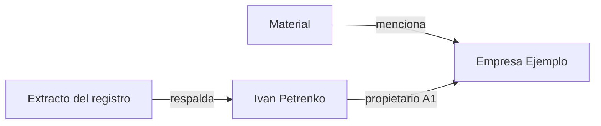

# Enlaces y grafo de conocimiento — principios y reglas

[🇺🇦 Українська](KNOWLEDGE_GRAPH.uk.md) · [🇬🇧 English](KNOWLEDGE_GRAPH.en.md) · [🇫🇷 Français](KNOWLEDGE_GRAPH.fr.md) · [🇩🇪 Deutsch](KNOWLEDGE_GRAPH.de.md) · **🇪🇸 Español** · [🇰🇷 한국어](KNOWLEDGE_GRAPH.ko.md) · [🇯🇵 日本語](KNOWLEDGE_GRAPH.ja.md)

> Válido para MD Notes v0.3.23. El texto ucraniano es canónico. Este documento describe el modelo de datos y el comportamiento actual; la posición visual de un nodo no forma parte del conocimiento.

## 1. Principio central

En MD Notes, **las notas son la fuente de verdad** y el grafo es una vista de ellas.

- nodo = nota;
- arista ordinaria = wiki-enlace resuelto;
- relación tipada = hecho estructurado explícito en el front matter YAML;
- el índice SQLite de `.mdnotes/cache` es una caché reconstruible;
- posición, color, forma y longitud de línea no cambian los datos.

El grafo puede reconstruirse desde Markdown.

## 2. Cuatro mecanismos de estructura

| Mecanismo | Función |
|---|---|
| carpetas | agrupación física |
| `[[wiki-enlaces]]` | conexiones semánticas libres |
| etiquetas | temas transversales |
| propiedades/front matter | hechos legibles por máquina, tipos y relaciones |

Compartir carpeta o etiqueta no crea una arista. Las aristas nacen de enlaces o de entradas explícitas en `relations`.

## 3. Wiki-enlaces ordinarios

```markdown
La empresa está dirigida por [[Iryna Fediura]].
Véase también [[Empresa Ejemplo|ficha de la empresa]].
```

Un enlace resuelto crea: `nota actual ───► nota objetivo`.

Los enlaces idénticos repetidos se deduplican. Un autoenlace no se muestra como arista separada. Si el objetivo no se resuelve a una nota existente, el grafo no debe inventar un nodo ni un hecho.

Un wiki-enlace solo significa: **«esta nota enlaza con aquella»**.

## 4. Relaciones tipadas

Para hechos que necesitan dirección, tipo, origen o valoración:

```yaml
---
title: Ivan Petrenko
type: person
relations:
  - to: "Empresa Ejemplo"
    type: "propietario"
    grade: "A1"
    origin: "registro mercantil"
    status: "confirmed"
    evidence: "Extracto del registro de 2026-10-30"
---
```

Lectura humana: **Ivan Petrenko → propietario → Empresa Ejemplo**.

| Campo | Obligatorio | Significado |
|---|---|---|
| `to` | sí | nota objetivo, resuelta como enlace interno |
| `type` | no | semántica de la relación |
| `grade` | no | valoración, letra + cifra |
| `origin` | no | origen del hecho |
| `status` | no | estado de verificación o ciclo de vida |
| `evidence` | no | prueba concreta |
| `dir` | no | `in` invierte la dirección; por defecto va desde la nota que contiene la entrada hacia `to` |

Un objetivo no resuelto no se convierte en hecho del grafo. Las autorrelaciones se ignoran. Los campos opcionales ausentes no deben inventarse.

### Dirección inversa

Si en «Empresa Ejemplo» hay una relación con `to: "Ivan Petrenko"` y `dir: in`, la dirección resultante es **Ivan Petrenko → Empresa Ejemplo**.

## 5. Valoraciones A1–F6

- letra **A–F**: valoración de la fuente;
- cifra **1–6**: valoración de la afirmación;
- **A1** es la combinación más fuerte y **F6** la más débil.

MD Notes no decide automáticamente qué es verdad. La valoración debe tener base.

Para lectura rápida la interfaz agrupa sobre todo la cifra: 1–2 fiable, 3–4 media, 5–6 débil/**RUMOR**, sin `grade` = sin valoración formal. El color nunca es la única señal.

## 6. Grafo global y local

El **grafo global** contiene todas las notas indexadas, los wiki-enlaces resueltos y las relaciones tipadas entre nodos conocidos. Una nota aislada puede aparecer sin aristas.

En v0.3.23, el **grafo local** muestra la nota activa más un **vecindario de un salto** formado por enlaces ordinarios resueltos.

Límite actual: una relación tipada por sí sola no amplía ese snapshot local; solo se superpone cuando ambos extremos ya son visibles.

## 7. Árbol de relaciones y cadenas

El árbol es direccional y parte de una raíz.

- `grade` junto al padre = mejor valoración de las líneas entre ese par;
- `pathGrade` = **valoración más débil de todo el camino** desde la raíz.

Una cadena no es más fiable que su eslabón más débil. Encontrar una ruta ayuda a navegar y analizar, pero no prueba por sí sola causalidad, propiedad u otra semántica.

## 8. Presentación no equivale a significado

La física flotante, fuerzas, repulsión, longitud de enlace, zoom y arrastre sirven solo para legibilidad. Las formas pueden indicar tipos de nota y los colores grados. No crean hechos.

## 9. Práctica recomendada

1. Una nota reutilizable por entidad importante.
2. `[[enlace]]` para una mención normal.
3. `relations` para hechos con tipo, dirección o prueba.
4. No asignar `grade` sin fundamento.
5. Añadir `origin` y `evidence` a relaciones importantes.
6. Evitar duplicar el mismo hecho en ambos sentidos; usar una entrada canónica y `dir`.
7. Tras importaciones masivas, revisar objetivos no resueltos.
8. No inferir significado por proximidad visual.

## 10. Ejemplo



Los datos primarios permanecen en Markdown/front matter. Si cambia la prueba, cambie la relación o `evidence/status/grade`.

## 11. Lo que el grafo no demuestra

Sin un hecho explícito no debe concluirse que un vecino común implica propietario común, que un wiki-enlace expresa causalidad jurídica, que un nodo rojo es «falso» o que la ausencia de arista demuestra ausencia de relación real.

El grafo muestra **lo registrado y resuelto**.

## 12. Automatización e IA

Reglas normativas para agentes:
- [GRAPH_CONTRACT.md](../ai/GRAPH_CONTRACT.md);
- [graph-contract.yaml](../ai/graph-contract.yaml).

Una IA no debe inventar una relación, `grade`, `origin` o `evidence` sin datos de respaldo.

> Traducción generada automáticamente y no revisada por un hablante nativo; el ucraniano es el texto canónico.
