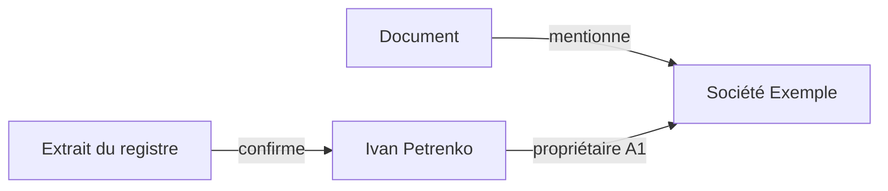

# Liens et graphe de connaissances — principes et règles

[🇺🇦 Українська](KNOWLEDGE_GRAPH.uk.md) · [🇬🇧 English](KNOWLEDGE_GRAPH.en.md) · **🇫🇷 Français** · [🇩🇪 Deutsch](KNOWLEDGE_GRAPH.de.md) · [🇪🇸 Español](KNOWLEDGE_GRAPH.es.md) · [🇰🇷 한국어](KNOWLEDGE_GRAPH.ko.md) · [🇯🇵 日本語](KNOWLEDGE_GRAPH.ja.md)

> Valable pour MD Notes v1.0.0. Le texte ukrainien est canonique. Ce document décrit le modèle de données et le comportement actuel ; la position visuelle des nœuds ne fait pas partie des connaissances.

## 1. Principe central

Dans MD Notes, **les notes sont la source de vérité** et le graphe n’est qu’une vue.

- nœud = note ;
- arête ordinaire = wiki-lien résolu d’une note vers une autre ;
- relation typée = fait structuré explicite dans le front matter YAML ;
- l’index SQLite de `.mdnotes/cache` est un cache reconstruisible ;
- position, couleur, forme et longueur des lignes ne modifient pas les données.

Le graphe peut donc être reconstruit à partir des fichiers Markdown.

## 2. Quatre mécanismes différents

| Mécanisme | Rôle |
|---|---|
| dossiers | regroupement physique des fichiers |
| `[[wiki-liens]]` | liens sémantiques libres |
| tags | thèmes transversaux |
| propriétés/front matter | faits lisibles par machine, types et relations typées |

Un dossier ou un tag commun ne crée pas automatiquement une arête. Une arête vient d’un lien ou d’une entrée `relations`.

## 3. Wiki-liens ordinaires

```markdown
La société est dirigée par [[Iryna Fediura]].
Voir aussi [[Société Exemple|fiche société]].
```

Un lien résolu donne : `note actuelle ───► note cible`.

Les doublons identiques sont dédupliqués. Un auto-lien n’est pas affiché comme arête distincte. Si la cible n’est pas résolue vers une note existante, le graphe ne doit inventer ni nœud ni fait.

Un wiki-lien signifie seulement : **« cette note renvoie vers cette autre note »**.

## 4. Relations typées

Pour un fait qui exige un sens, un type, une source ou une évaluation :

```yaml
---
title: Ivan Petrenko
type: person
relations:
  - to: "Société Exemple"
    type: "propriétaire"
    grade: "A1"
    origin: "registre des sociétés"
    status: "confirmed"
    evidence: "Extrait du registre du 2026-10-30"
---
```

Lecture : **Ivan Petrenko → propriétaire → Société Exemple**.

| Champ | Obligatoire | Signification |
|---|---|---|
| `to` | oui | note cible, résolue comme un lien interne |
| `type` | non | sémantique de la relation |
| `grade` | non | fiabilité, lettre + chiffre, ex. `A1` |
| `origin` | non | origine du fait |
| `status` | non | état de vérification ou de vie du fait |
| `evidence` | non | preuve concrète |
| `dir` | non | `in` inverse le sens ; sinon la relation part de la note qui contient l’entrée vers `to` |

Une cible non résolue ne devient pas un fait du graphe. Les auto-relations sont ignorées. Les champs absents ne doivent pas être inventés.

### Sens inverse

Si une relation stockée dans « Société Exemple » contient `to: "Ivan Petrenko"` et `dir: in`, le sens dans le graphe est **Ivan Petrenko → Société Exemple**.

## 5. Notes A1–F6

- lettre **A–F** : évaluation de la source ;
- chiffre **1–6** : évaluation de l’affirmation ;
- **A1** est la combinaison la plus forte, **F6** la plus faible.

MD Notes ne décide pas automatiquement de la vérité. Une note doit avoir une base vérifiable.

Pour la lecture rapide, l’interface groupe surtout le chiffre : 1–2 fiable, 3–4 moyen, 5–6 faible/**RUMEUR**, sans `grade` = non évalué. La couleur n’est jamais le seul signal.

## 6. Graphe global et local

Le **graphe global** contient toutes les notes indexées, les wiki-liens résolus et les relations typées entre nœuds connus. Une note isolée peut être un nœud sans arête.

Dans v1.0.0, le **graphe local** montre la note active et un **voisinage d’un saut** construit à partir des liens ordinaires résolus.

Limite actuelle : une relation typée seule n’agrandit pas ce snapshot local ; elle est superposée lorsque ses deux extrémités sont déjà visibles.

## 7. Arbre de relations et chaînes

L’arbre est directionnel et part d’une racine.

- `grade` près d’un parent = meilleure note parmi les lignes entre cette paire ;
- `pathGrade` = **note la plus faible de tout le chemin** depuis la racine.

Ainsi, une chaîne n’est pas plus fiable que son maillon le plus faible. La recherche d’un chemin sert à la navigation et à l’analyse ; elle ne prouve pas à elle seule la causalité ou la propriété.

## 8. Présentation ≠ signification

Physique flottante, forces, répulsion, longueur des liens, zoom et glisser-déposer servent à la lisibilité. Les formes peuvent représenter les types, les couleurs les grades. Elles ne créent aucun fait.

## 9. Bonnes pratiques

1. Une note réutilisable par entité importante.
2. Un `[[lien]]` pour une mention ordinaire.
3. `relations` pour les faits qui demandent type, sens ou preuve.
4. Pas de `grade` sans base.
5. Ajouter `origin` et `evidence` aux relations importantes.
6. Éviter de dupliquer le même fait dans les deux sens ; choisir une entrée canonique et `dir`.
7. Après import massif, vérifier les cibles non résolues.
8. Ne jamais déduire un sens de la proximité visuelle.

## 10. Exemple



Les données primaires restent dans Markdown/front matter. Quand la preuve change, modifier la relation ou `evidence/status/grade`.

## 11. Ce que le graphe ne prouve pas

Sans fait explicite, il ne faut pas conclure qu’un voisin commun implique un propriétaire commun, qu’un wiki-lien exprime une causalité juridique, qu’un nœud rouge est « faux », ou que l’absence d’arête prouve l’absence de relation réelle.

Le graphe montre **ce qui est enregistré et résolu**.

## 12. Automatisation et IA

Les règles normatives pour les agents sont séparées :
- [GRAPH_CONTRACT.md](../ai/GRAPH_CONTRACT.md) ;
- [graph-contract.yaml](../ai/graph-contract.yaml).

Une IA ne doit pas inventer une relation, un `grade`, une `origin` ou une `evidence` sans données justificatives.

> Traduction générée automatiquement et non relue par un locuteur natif ; l’ukrainien est la version canonique.
