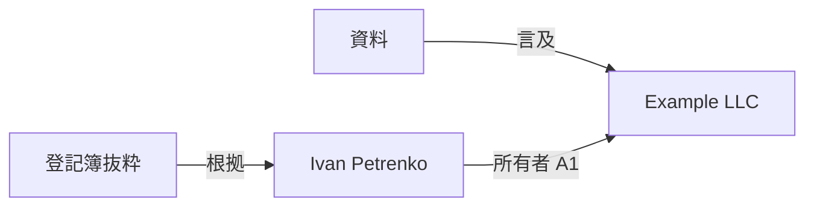

# 知識リンクとグラフ — 原則とルール

[🇺🇦 Українська](KNOWLEDGE_GRAPH.uk.md) · [🇬🇧 English](KNOWLEDGE_GRAPH.en.md) · [🇫🇷 Français](KNOWLEDGE_GRAPH.fr.md) · [🇩🇪 Deutsch](KNOWLEDGE_GRAPH.de.md) · [🇪🇸 Español](KNOWLEDGE_GRAPH.es.md) · [🇰🇷 한국어](KNOWLEDGE_GRAPH.ko.md) · **🇯🇵 日本語**

> MD Notes v1.0.0 を対象とします。ウクライナ語版が正本です。この文書は実際のデータモデルと現行動作を説明します。画面上のノード位置は知識そのものではありません。

## 1. 基本原則

MD Notes では **ノートが source of truth** であり、グラフはその表示です。

- ノード = ノート
- 通常の辺 = あるノートから別のノートへ解決された wiki リンク
- 型付き関係 = YAML front matter に明示された構造化された事実
- `.mdnotes/cache` の SQLite インデックス = 再構築可能なキャッシュ
- ノード位置、色、形、線の長さはデータそのものを変更しない

したがってグラフは Markdown から再構築できます。

## 2. 4つの構造化手段

| 手段 | 役割 |
|---|---|
| フォルダー | ファイルの物理的なグループ |
| `[[wikiリンク]]` | 自由な意味上のつながり |
| タグ | 横断的なテーマと分類 |
| プロパティ/front matter | 機械可読な事実、型、型付き関係 |

同じフォルダーやタグだけでは辺は作られません。辺はリンクまたは明示的な `relations` から生まれます。

## 3. 通常の wiki リンク

```markdown
この会社の責任者は [[Iryna Fediura]] です。
[[Example LLC|会社カード]] も参照してください。
```

解決されたリンクは `現在のノート ───► 対象ノート` を作ります。

同一リンクの繰り返しは重複辺になりません。自己リンクは別の辺として表示されません。対象が既存ノートに解決できない場合、グラフはノードや事実を創作してはいけません。

wiki リンクの意味は **「このノートがそのノートを参照する」** だけです。

## 4. 型付き関係

方向、種類、出所、信頼度が必要な事実は `relations` に記録します。

```yaml
---
title: Ivan Petrenko
type: person
relations:
  - to: "Example LLC"
    type: "owner"
    grade: "A1"
    origin: "company register"
    status: "confirmed"
    evidence: "2026-10-30 の登記簿抜粋"
---
```

人が読むと **Ivan Petrenko → 所有者 → Example LLC** です。

| フィールド | 必須 | 意味 |
|---|---|---|
| `to` | はい | 内部リンクと同様に解決される対象ノート |
| `type` | いいえ | 関係の意味 |
| `grade` | いいえ | 文字+数字の信頼度評価 |
| `origin` | いいえ | 事実の出所 |
| `status` | いいえ | 検証/状態 |
| `evidence` | いいえ | 具体的な根拠 |
| `dir` | いいえ | `in` で向きを反転。既定は記録元ノートから `to` へ |

`to` が解決できなければグラフ上の事実にはなりません。自己関係は無視されます。省略された任意フィールドを推測してはいけません。

### 逆方向

「Example LLC」ノートに `to: "Ivan Petrenko"` と `dir: in` がある場合、グラフ上の方向は **Ivan Petrenko → Example LLC** です。

## 5. A1–F6 評価

- **A–F**: 情報源の評価
- **1–6**: 主張の評価
- **A1** が最も強く、**F6** が最も弱い組み合わせ

MD Notes は真偽を自動決定しません。評価には根拠が必要です。

素早い表示では主に数字をまとめます。1–2 は信頼、3–4 は中程度、5–6 は弱い/**噂**、`grade` なしは正式評価なしです。色だけを唯一の信号にはしません。

## 6. グローバルグラフとローカルグラフ

**グローバルグラフ**は全インデックス済みノート、解決済み wiki リンク、既知ノード間の型付き関係を含みます。孤立したノートが辺なしで存在しても正常です。

v1.0.0 の **ローカルグラフ**は、アクティブノートと通常リンクによる **1 hop の近傍**を表示します。

現行の制限: 型付き relation だけではローカル snapshot を広げません。両端がすでに表示対象に含まれている場合に重ねて表示されます。

## 7. 関係ツリーとチェーン

関係ツリーは方向付きで、選択したルートから始まります。

- 親との `grade` = そのペア間の線のうち最良の評価
- `pathGrade` = ルートからそのノードまでの **経路全体で最も弱い評価**

つまりチェーンの信頼度は最も弱いリンクより高くはなりません。経路検索はナビゲーション/分析用であり、経路があるだけで因果関係や所有関係を証明しません。

## 8. 表示と意味は別物

浮遊物理、力、反発、リンク長、ズーム、ドラッグは読みやすさのためだけです。形はノート型、色は評価を表せますが、新しい事実を作るものではありません。

## 9. 推奨運用

1. 人物、企業、文書、イベントなど再利用する実体は独立したノートにする。
2. 普通の言及は `[[リンク]]`。
3. 型・方向・根拠が必要な事実は `relations`。
4. 根拠なしに `grade` を付けない。
5. 重要な関係には `origin` と `evidence` を付ける。
6. 同じ事実を両側のノートに不要に二重記録せず、正本の場所と `dir` を決める。
7. 一括インポート後は未解決対象を確認する。
8. 画面上の近さだけで意味を推論しない。

## 10. 例



一次データは Markdown/front matter に残します。根拠が変わったら relation または `evidence/status/grade` を更新します。

## 11. グラフが自動的には証明しないこと

明示された事実なしに、共通の隣接ノードから共通所有者を推測したり、通常の wiki リンク方向を法的/因果的方向とみなしたりしてはいけません。赤いノードが自動的に「偽」という意味でもなく、辺がないことが現実の関係不存在を証明するわけでもありません。

グラフが示すのは **記録され、解決された情報** です。

## 12. 自動化と AI

エージェント向けの規範ルール:
- [GRAPH_CONTRACT.md](../ai/GRAPH_CONTRACT.md)
- [graph-contract.yaml](../ai/graph-contract.yaml)

AI は裏付けデータなしに relation、`grade`、`origin`、`evidence` を創作してはいけません。

> 自動生成翻訳であり、ネイティブによる校閲は未実施です。ウクライナ語版が正本です。
