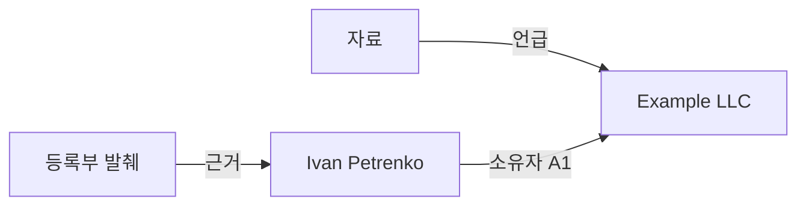

# 지식 연결과 그래프 — 원칙과 규칙

[🇺🇦 Українська](KNOWLEDGE_GRAPH.uk.md) · [🇬🇧 English](KNOWLEDGE_GRAPH.en.md) · [🇫🇷 Français](KNOWLEDGE_GRAPH.fr.md) · [🇩🇪 Deutsch](KNOWLEDGE_GRAPH.de.md) · [🇪🇸 Español](KNOWLEDGE_GRAPH.es.md) · **🇰🇷 한국어** · [🇯🇵 日本語](KNOWLEDGE_GRAPH.ja.md)

> MD Notes v0.3.23 기준입니다. 우크라이나어 문서가 기준본입니다. 이 문서는 실제 데이터 모델과 현재 동작을 설명하며, 화면에서의 노드 위치는 지식 자체가 아닙니다.

## 1. 핵심 원칙

MD Notes에서는 **노트가 진실의 원본(source of truth)** 이고 그래프는 그 표현입니다.

- 노드 = 노트
- 일반 간선 = 한 노트에서 다른 노트로 해석된 위키 링크
- 유형 관계 = YAML front matter에 명시된 구조화된 사실
- `.mdnotes/cache`의 SQLite 인덱스 = 다시 만들 수 있는 캐시
- 위치, 색, 모양, 선 길이는 원본 데이터를 바꾸지 않음

따라서 그래프는 Markdown에서 다시 생성할 수 있습니다.

## 2. 서로 다른 네 가지 구조화 방법

| 방법 | 역할 |
|---|---|
| 폴더 | 파일의 물리적 그룹 |
| `[[위키 링크]]` | 자유로운 의미 연결 |
| 태그 | 주제와 분류 |
| 속성/front matter | 기계가 읽을 수 있는 사실, 유형, 관계 |

같은 폴더나 같은 태그만으로는 그래프 간선이 생기지 않습니다. 간선은 링크 또는 명시적 `relations`에서 생깁니다.

## 3. 일반 위키 링크

```markdown
이 회사의 책임자는 [[Iryna Fediura]]입니다.
[[Example LLC|회사 카드]]도 참고하십시오.
```

해석된 링크는 `현재 노트 ───► 대상 노트` 방향을 만듭니다.

같은 링크가 반복되어도 중복 간선은 만들지 않습니다. 자기 자신을 가리키는 링크는 별도 간선으로 표시하지 않습니다. 대상이 기존 노트로 해석되지 않으면 그래프는 노드나 사실을 만들어 내면 안 됩니다.

위키 링크의 의미는 단지 **“이 노트가 저 노트를 가리킨다”** 입니다.

## 4. 유형 관계

방향, 종류, 출처, 신뢰도 평가가 필요한 사실은 `relations`에 기록합니다.

```yaml
---
title: Ivan Petrenko
type: person
relations:
  - to: "Example LLC"
    type: "owner"
    grade: "A1"
    origin: "company register"
    status: "confirmed"
    evidence: "2026-10-30 등록부 발췌"
---
```

사람이 읽으면 **Ivan Petrenko → 소유자 → Example LLC** 입니다.

| 필드 | 필수 | 의미 |
|---|---|---|
| `to` | 예 | 내부 링크처럼 해석되는 대상 노트 |
| `type` | 아니오 | 관계의 의미 |
| `grade` | 아니오 | 문자+숫자 신뢰도 평가 |
| `origin` | 아니오 | 사실의 출처 |
| `status` | 아니오 | 검증/상태 |
| `evidence` | 아니오 | 구체적인 근거 |
| `dir` | 아니오 | `in`이면 방향을 반전; 기본은 현재 노트에서 `to` 방향 |

`to`가 해석되지 않으면 그래프 사실이 되지 않습니다. 자기 관계는 무시됩니다. 없는 선택 필드는 추측해서 채우면 안 됩니다.

### 반대 방향

«Example LLC» 노트에 `to: "Ivan Petrenko"`, `dir: in`이 있으면 그래프 방향은 **Ivan Petrenko → Example LLC** 가 됩니다.

## 5. A1–F6 평가

- **A–F 문자**: 출처 평가
- **1–6 숫자**: 주장 평가
- **A1**이 가장 강하고 **F6**이 가장 약한 조합

MD Notes가 사실 여부를 자동 판정하지는 않습니다. 평가는 근거가 있어야 합니다.

빠른 시각화에서는 주로 숫자를 사용합니다: 1–2 신뢰, 3–4 중간, 5–6 약함/**소문**, `grade` 없음 = 공식 평가 없음. 색상만이 유일한 신호가 되어서는 안 됩니다.

## 6. 전체 그래프와 로컬 그래프

**전체 그래프**는 모든 인덱스 노트, 해석된 위키 링크, 알려진 노드 사이의 유형 관계를 포함합니다. 연결이 없는 노트도 단독 노드로 있을 수 있습니다.

v0.3.23의 **로컬 그래프**는 활성 노트와 일반 링크를 기준으로 한 **1-hop 이웃**을 보여 줍니다.

현재 한계: 유형 관계만으로는 로컬 스냅샷이 확장되지 않습니다. 두 끝 노드가 이미 보이는 집합에 있을 때 관계가 겹쳐 표시됩니다.

## 7. 관계 트리와 체인

관계 트리는 방향성이 있고 선택한 루트에서 시작합니다.

- 부모와의 `grade` = 그 두 노드 사이 선들 중 가장 좋은 평가
- `pathGrade` = 루트에서 해당 노드까지 **전체 경로의 가장 약한 평가**

즉 체인의 신뢰도는 가장 약한 고리보다 높을 수 없습니다. 경로 찾기는 탐색/분석 도구일 뿐, 그 자체로 인과관계나 소유관계를 증명하지 않습니다.

## 8. 표현은 의미가 아닙니다

떠다니는 물리, 힘, 반발, 선 길이, 확대/축소, 드래그는 읽기 편하게 하기 위한 것입니다. 모양은 노트 유형을, 색은 평가를 나타낼 수 있지만 새로운 사실을 만들지는 않습니다.

## 9. 권장 사용법

1. 사람, 회사, 문서, 사건 같은 재사용 엔터티는 별도 노트로 만듭니다.
2. 일반 언급은 `[[링크]]`를 사용합니다.
3. 유형/방향/근거가 필요한 사실은 `relations`를 사용합니다.
4. 근거가 없으면 `grade`를 넣지 않습니다.
5. 중요한 관계에는 `origin`과 `evidence`를 추가합니다.
6. 같은 사실을 양쪽 노트에 중복 기록하지 말고, 한 곳을 기준으로 정하고 `dir`을 사용합니다.
7. 대량 가져오기 후 해석되지 않은 대상을 확인합니다.
8. 화면에서 가까이 있다는 이유만으로 의미를 추론하지 않습니다.

## 10. 예시



원본 데이터는 Markdown/front matter에 남아야 합니다. 근거가 바뀌면 relation 또는 `evidence/status/grade`를 수정합니다.

## 11. 그래프가 자동으로 증명하지 않는 것

명시된 사실이 없으면 공통 이웃이 공통 소유자를 뜻한다고 볼 수 없고, 일반 위키 링크 방향을 법적/인과 방향으로 볼 수도 없습니다. 빨간 노드가 자동으로 “거짓”인 것도 아니며, 간선이 없다고 현실의 관계가 없다는 뜻도 아닙니다.

그래프는 **기록되고 해석된 것**을 보여 줍니다.

## 12. 자동화와 AI

에이전트용 규범 규칙:
- [GRAPH_CONTRACT.md](../ai/GRAPH_CONTRACT.md)
- [graph-contract.yaml](../ai/graph-contract.yaml)

AI는 근거 데이터 없이 relation, `grade`, `origin`, `evidence`를 만들어 내면 안 됩니다.

> 자동 생성 번역이며 원어민 검수를 거치지 않았습니다. 우크라이나어 문서가 기준입니다.
