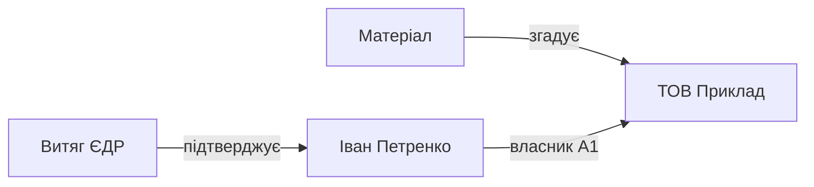

# Зв’язки та граф знань — принципи і правила

**🇺🇦 Українська** · [🇬🇧 English](KNOWLEDGE_GRAPH.en.md) · [🇫🇷 Français](KNOWLEDGE_GRAPH.fr.md) · [🇩🇪 Deutsch](KNOWLEDGE_GRAPH.de.md) · [🇪🇸 Español](KNOWLEDGE_GRAPH.es.md) · [🇰🇷 한국어](KNOWLEDGE_GRAPH.ko.md) · [🇯🇵 日本語](KNOWLEDGE_GRAPH.ja.md)

> Актуально для MD Notes v0.3.23. Канонічна версія цього документа — українська. Цей текст пояснює фактичну модель даних і поведінку поточного продукту; візуальне розташування вузлів не є частиною змісту знань.

## 1. Головний принцип

У MD Notes **нотатки є джерелом істини**, а граф — лише їхнім поданням.

- вузол = нотатка;
- звичайне ребро = розв’язане wiki-посилання з однієї нотатки на іншу;
- типізований зв’язок = явний структурований факт із YAML front matter;
- SQLite-індекс у `.mdnotes/cache` — перебудовуваний кеш, а не окреме сховище знань;
- позиція вузла на екрані, колір, форма й довжина лінії не змінюють самі дані.

Тому граф можна перебудувати з Markdown-файлів. Не слід редагувати «граф як картинку» замість редагування нотаток.

## 2. Чотири різні способи структурувати знання

MD Notes не зводить усе до одного графа:

| Механізм | Для чого |
|---|---|
| папки | фізичне групування: де лежить файл |
| `[[wiki-посилання]]` | вільний змістовий зв’язок між нотатками |
| теги | наскрізні теми та класифікація |
| властивості/front matter | машиночитні факти, типи й типізовані зв’язки |

Папка не означає автоматичний зв’язок у графі. Однаковий тег також сам по собі не створює ребро. Ребро виникає через посилання або через явний запис `relations`.

## 3. Звичайні wiki-посилання

Приклад:

```markdown
Компанію очолює [[Ірина Федюра]].

Див. також [[ТОВ Приклад|картку компанії]].
```

Після індексації розв’язане посилання створює напрямок:

```text
поточна нотатка  ───►  цільова нотатка
```

Повторення одного й того самого посилання в одній нотатці не створює кілька однакових ребер. Самопосилання не показується як окреме ребро. Якщо ціль не вдалося однозначно розв’язати в наявну нотатку, граф не повинен вигадувати вузол або факт.

Wiki-посилання означає лише: **«ця нотатка посилається на ту»**. Воно не каже, *який саме* це зв’язок і наскільки надійним є твердження.

## 4. Типізовані зв’язки

Для фактів, яким потрібні напрямок, тип, джерело або оцінка, використовується список `relations` у YAML front matter:

```yaml
---
title: Іван Петренко
type: person
relations:
  - to: "ТОВ Приклад"
    type: "власник"
    grade: "A1"
    origin: "ЄДР"
    status: "confirmed"
    evidence: "Витяг ЄДР від 2026-10-30"
---
```

Людською мовою: **Іван Петренко → власник → ТОВ Приклад**, джерело — ЄДР, доказ — конкретний витяг.

### Поля relation

| Поле | Обов’язковість | Значення |
|---|---|---|
| `to` | обов’язкове | цільова нотатка; розв’язується як внутрішнє посилання |
| `type` | необов’язкове | семантика: власник, керівник, учасник, згадує, джерело тощо |
| `grade` | необов’язкове | оцінка надійності у форматі літера + цифра, напр. `A1` |
| `origin` | необов’язкове | звідки факт отримано: реєстр, документ, інтерв’ю тощо |
| `status` | необов’язкове | стан перевірки або життєвий стан факту |
| `evidence` | необов’язкове | конкретна підстава, документ, цитата або посилання на доказ |
| `dir` | необов’язкове | `in` розвертає напрямок; без нього напрямок іде від нотатки-власника запису до `to` |

Якщо `to` не розв’язується, relation не перетворюється на графовий факт. Якщо relation веде на ту саму нотатку, він ігнорується. Відсутні необов’язкові поля не можна домислювати.

### Зворотний напрямок

```yaml
relations:
  - to: "Іван Петренко"
    type: "owned by"
    dir: "in"
    grade: "A1"
```

Якщо цей запис лежить у нотатці «ТОВ Приклад», `dir: in` означає, що в графі напрямок буде **Іван Петренко → ТОВ Приклад**.

## 5. Оцінка A1–F6

Оцінка має дві частини:

- **літера A–F** — оцінка джерела;
- **цифра 1–6** — оцінка самого твердження;
- **A1** — найсильніша комбінація, **F6** — найслабша.

MD Notes не визначає істину автоматично. Оцінку задає людина або контрольований процес імпорту/аналізу, який має мати підставу.

Для швидкого візуального читання інтерфейс групує насамперед цифрову частину:
- 1–2 — надійні;
- 3–4 — середні;
- 5–6 — слабкі/позначаються як **«ЧУТКА»**;
- без `grade` — немає формальної оцінки.

Колір — лише допоміжний сигнал. Текстова оцінка й позначка мають залишатися зрозумілими без кольору.

## 6. Як будується глобальний і локальний граф

### Глобальний граф

Глобальний граф бере всі індексовані нотатки як вузли, збирає розв’язані вихідні/вхідні wiki-посилання й накладає на них доступні типізовані relations.

Ізольована нотатка може бути вузлом без ребер — це нормально.

### Локальний граф

Поточна реалізація локального графа v0.3.23 показує активну нотатку та **один крок сусідства** за розв’язаними звичайними посиланнями.

Важлива межа поточної реалізації: типізований relation сам по собі не розширює локальний snapshot. Він відображається, коли обидва його кінці вже входять у видиму множину вузлів. У глобальному графі це обмеження практично не виникає, бо там присутні всі індексовані нотатки.

## 7. Дерево зв’язків і ланцюжок

Дерево зв’язків показує не «випадкову фізику», а напрямлену структуру від вибраного кореня.

Для кожної ланки:
- `grade` вузла біля батька — найкраща оцінка серед ліній між цією парою;
- `pathGrade` — **найслабша оцінка на всьому шляху** від кореня до цього вузла.

Це принцип «ланцюг не надійніший за свою найслабшу ланку». Якщо шлях A → B → C містить сильний зв’язок і один слабкий, для висновку про весь шлях треба бачити слабку ланку, а не усереднювати її.

Пошук шляху між двома нотатками — інструмент навігації/аналізу. Сам факт існування шляху не доводить причинність, власність або іншу семантику поза записаними типами relations.

## 8. Відображення не дорівнює змісту

«Плаваюча» фізика, сили, відштовхування, довжина ліній, масштаб і ручне перетягування призначені лише для читабельності.

Форми можуть показувати тип нотатки. Колір/стиль лінії можуть показувати оцінку relation. Вони **не створюють нових фактів**.

Після перезапуску або іншої розкладки вузли можуть опинитися в інших місцях, але семантика бази знань не зміниться.

## 9. Рекомендована практика

1. Створюйте окрему нотатку для сутності, яку треба повторно використовувати: людини, компанії, документа, події.
2. Для звичайної згадки використовуйте `[[посилання]]`.
3. Для факту, що потребує пояснення «хто/що/до кого/на якій підставі», використовуйте `relations`.
4. Не ставте `grade`, якщо оцінювати надійність немає підстав.
5. Для важливого relation додавайте `origin` і `evidence`.
6. Не створюйте обидва напрямки одного факту в двох нотатках без потреби — це може породити дублікати семантики. Оберіть канонічне місце запису й правильний `dir`.
7. Після масового імпорту перевіряйте нерозв’язані цілі та неоднозначні назви.
8. Не робіть висновок лише з близькості вузлів на екрані.

## 10. Приклад: від матеріалу до власника



Цей малюнок корисний для читання, але первинні дані мають бути в Markdown/front matter. Якщо доказ зміниться, змінюється relation або його `evidence/status/grade`, а не «малюнок графа».

## 11. Що не можна автоматично виводити з графа

Без окремого записаного правила або факту не можна стверджувати, що:
- два сусідні вузли мають однаковий тип відносин;
- спільний сусід означає спільного власника;
- напрямок простого wiki-link означає юридичний або причинний напрямок;
- червоний вузол є «неправдивим» — це лише слабша оцінка evidence;
- відсутність ребра доводить відсутність реального зв’язку.

Граф показує **те, що записано й розв’язано**, а не повну картину реального світу.

## 12. Для автоматизації та ШІ

Людський документ пояснює сенс. Для агентів і автоматичних редакторів канонічні правила винесено окремо:

- [GRAPH_CONTRACT.md](../ai/GRAPH_CONTRACT.md) — нормативний контракт;
- [graph-contract.yaml](../ai/graph-contract.yaml) — машиночитна форма.

ШІ не повинен вигадувати relation, `grade`, `origin` або `evidence` без даних, що це підтверджують.
