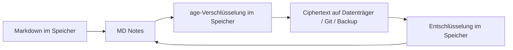

# Verschlüsselter Vault — Funktionsweise, Schlüssel und Schutzgrenzen

[🇺🇦 Українська](ENCRYPTED_VAULT.uk.md) · [🇬🇧 English](ENCRYPTED_VAULT.en.md) · [🇫🇷 Français](ENCRYPTED_VAULT.fr.md) · **🇩🇪 Deutsch** · [🇪🇸 Español](ENCRYPTED_VAULT.es.md) · [🇰🇷 한국어](ENCRYPTED_VAULT.ko.md) · [🇯🇵 日本語](ENCRYPTED_VAULT.ja.md)

> Gilt für MD Notes v1.0.0. Ukrainisch ist kanonisch. Beschrieben wird das tatsächliche Produktverhalten, nicht nur die Absicht von ADR-0007.

## 1. Zweck

Ein normaler Vault enthält offene Markdown-Dateien. Der optionale **verschlüsselte Vault** schützt Kopien auf externen Datenträgern, in Git, synchronisierten Cloud-Ordnern, Backups oder auf einem verlorenen Gerät.

Verwendet werden das offene **age**-Format und X25519-Schlüssel. MD Notes erfindet keine eigene Kryptografie.

## 2. Prinzip

Die App arbeitet logisch mit `projects/secret-note.md`, verschlüsselt die Bytes aber im Speicher, bevor sie an den physischen Speicher geschrieben werden.

Der darunterliegende Storage Provider darf keinen Klartext von Notizen oder Anhängen erhalten.

## 3. Zufallsnamen neuer Vaults

Neue v1.0.0-Vaults verwenden **random names**, z. B. `k8r2p6m1q4x7z9ab.age`. Der logische Pfad liegt innerhalb der verschlüsselten Hülle.

Damit sind Notiz- und Ordnernamen gegenüber Dateisystem und Git verborgen. Ältere Vaults können im `named`-Modus bleiben; dort sind Namen sichtbar, Inhalte aber verschlüsselt.

Anzahl, Größe, Änderungszeiten und offene Servicemetadaten bleiben grundsätzlich beobachtbar.

## 4. Was verschlüsselt wird

Normale Vault-Dateien und `.mdnotes/trash/` werden verschlüsselt. Der übrige Bereich `.mdnotes/` ist im Allgemeinen offene Servicemetadaten.

`.mdnotes/encryption.json` ist nicht geheim. Er enthält Format/Version, `vaultId`, öffentliche `age1...`-Empfänger und das Namenslayout. Private Schlüssel stehen dort nicht.

## 5. Privater Schlüssel

Ein privater Schlüssel sieht wie `AGE-SECRET-KEY-...` aus.

Er darf niemals im Vault, in `localStorage`, Git, Logs oder im Vault-Backup liegen.

MD Notes speichert ihn im Secret Store des Betriebssystems: Windows Credential Manager, macOS Keychain oder Linux Secret Service.

Bei der Erstellung muss eine unabhängige Wiederherstellungskopie gesichert werden. Sind alle nutzbaren Schlüssel verloren, ist der Ciphertext nicht wiederherstellbar.

## 6. Anderes Gerät

Vault kopieren/wiederherstellen, öffnen und bei fehlendem Geräteschlüssel `AGE-SECRET-KEY-...` separat importieren. Danach liegt er im OS Secret Store des neuen Geräts.

Vault und privaten Schlüssel möglichst nicht über denselben Kanal transportieren.

## 7. Recovery-Empfänger

age kann für mehrere öffentliche Empfänger verschlüsseln. Empfohlen: Arbeitsschlüssel im Secret Store, Recovery-Privatschlüssel getrennt/offline, nur öffentliche Schlüssel im Vault.

In der 1.0-Stabilisierung kann auch einem **bereits vorhandenen** verschlüsselten Vault über **Datei → „Wiederherstellungsschlüssel verwalten…“** ein Recovery-Empfänger hinzugefügt werden. Eingefügt wird nur der öffentliche `age1…`-Schlüssel; MD Notes verschlüsselt die Vault-Dateien für alle Empfänger neu. Der private Recovery-Schlüssel bleibt außerhalb des Vaults.

## 8. Cache/Index

`.mdnotes/cache/index.db` bleibt ein offener lokaler Cache und kann abgeleitete Klartextdaten für Suche und Graph enthalten.

Er wird nicht synchronisiert, nicht in Git aufgenommen und vom eingebauten Backup ausgeschlossen. Sein Schutz hängt von OS-Konto und Datenträgerverschlüsselung ab.

„Encrypted vault“ bedeutet daher nicht vollständige Verschlüsselung jedes MD-Notes-Bytes.

## 9. Anhänge

In der 1.0-Stabilisierung werden Bilder und PDFs eines verschlüsselten Vaults über den aktiven Storage Provider gelesen, **nur im Speicher** entschlüsselt und über In-Memory-Blob-URLs angezeigt. Es wird keine Klartext-Temporärdatei auf den Datenträger geschrieben.

Das externe **„Datei öffnen“** ist für verschlüsselte Anhänge absichtlich deaktiviert, weil die Übergabe an eine andere Anwendung eine Klartextkopie auf dem Datenträger erfordern würde. Andere Anhangstypen bleiben korrekt verschlüsselt, auch wenn sie keine Inline-Vorschau haben.

## 10. Git

Ein Guard soll Klartext-Push verhindern. Neue Zufallsnamen-Vaults zeigen Git nur zufällige `*.age`-Dateien; alte `named`-Vaults können Pfadnamen offenlegen.

Git sichert keinen privaten Schlüssel.

## 11. Backup

Das eingebaute Backup kopiert den physischen Zustand; beim verschlüsselten Vault also Ciphertext. Ausgeschlossen sind `.git`, `.mdnotes/cache`, privater Schlüssel und Recovery-Privatschlüssel.

Archiv und Wiederherstellungsschlüssel sind **zwei unabhängige Komponenten**. Siehe [Backup und Wiederherstellung](BACKUP_AND_RECOVERY.de.md).

## 12. Wogegen es schützt

Eine Vault-Kopie ohne Schlüssel — gestohlene ZIP-Datei, Git-Kopie, Sync-Ordner oder separater Datenträger — bleibt unlesbar.

## 13. Wogegen es nicht schützt

Kein Schutz gegen Malware im bereits entsperrten Konto, kompromittierten Secret Store, Bildschirmaufnahme, Verlust aller Schlüssel, Klartextdaten im lokalen Cache oder Metadatenanalyse.

Für sensible Daten mit BitLocker/FileVault/LUKS und Kontosperre kombinieren.

## 14. Sichere Vorgehensweise

**Erstellung**: vertrauenswürdige Umgebung → Schlüssel getrennt sichern → Wiederöffnung testen → erstes Backup.

**Migration**: Vault ohne Schlüssel kopieren → MD Notes installieren → öffnen → Schlüssel über getrennten Kanal importieren → mehrere Notizen und Graph prüfen.

**Geräteverlust**: Ciphertext aus Backup/Git/Sync und Schlüssel separat wiederherstellen. MD Notes besitzt keinen Master Key.

## 15. Automatisierung und KI

Normative Regeln:
- [ENCRYPTED_VAULT_CONTRACT.md](../ai/ENCRYPTED_VAULT_CONTRACT.md);
- [encrypted-vault-contract.yaml](../ai/encrypted-vault-contract.yaml).

Eine KI darf private Schlüssel niemals in Vault/Git/Logs schreiben, keine dauerhaften Klartextkopien „zur Bequemlichkeit“ erzeugen, den Cache nicht als verschlüsselt bezeichnen und keine Wiederherstellung verlorener Schlüssel versprechen.

> Automatisch erzeugte, nicht muttersprachlich geprüfte Übersetzung; Ukrainisch ist kanonisch.
