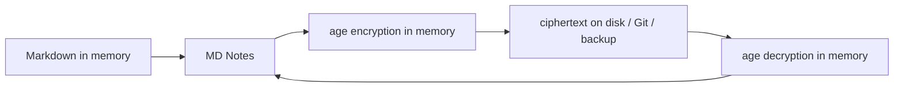

# Encrypted vault — how it works, keys and protection boundaries

[🇺🇦 Українська](ENCRYPTED_VAULT.uk.md) · **🇬🇧 English** · [🇫🇷 Français](ENCRYPTED_VAULT.fr.md) · [🇩🇪 Deutsch](ENCRYPTED_VAULT.de.md) · [🇪🇸 Español](ENCRYPTED_VAULT.es.md) · [🇰🇷 한국어](ENCRYPTED_VAULT.ko.md) · [🇯🇵 日本語](ENCRYPTED_VAULT.ja.md)

> Applies to MD Notes v0.3.23. Ukrainian is canonical. This describes actual product behavior, not merely the design intent of ADR-0007.

## 1. Purpose

A normal MD Notes vault contains open Markdown files. An optional **encrypted vault** is intended for copies that may end up on external media, in Git, in a synced cloud folder, in backups, or on a lost device.

It uses the open **age** format with X25519 keys. MD Notes does not invent its own cryptography.

## 2. Core principle

The app logically works with a path such as `projects/secret-note.md`, but encrypts the bytes in memory before writing them to physical storage.



The underlying storage provider must not receive note or attachment plaintext.

## 3. New v0.3.23 encrypted vault layout

New encrypted vaults use **random names**. A logical path is not stored as a readable filesystem name. A physical file may look like:

```text
k8r2p6m1q4x7z9ab.age
```

The logical path is stored inside the encrypted MD Notes envelope.

This hides note and folder names from the filesystem and Git for newly created vaults. Older vaults created before random-name layout may remain in `named` mode, where names/folders are visible while content is encrypted.

Random names still do not hide file count, approximate sizes, modification times or open service metadata.

## 4. What is encrypted

`EncryptedProvider` encrypts ordinary vault files before delegating to physical storage. `.mdnotes/trash/` also keeps encrypted data.

The rest of `.mdnotes/` is generally **open service metadata**. In particular, `.mdnotes/encryption.json` is not secret. It contains only configuration and **public** recipients:
- format/version;
- `vaultId`;
- `recipients` (`age1...`);
- `random` or legacy `named` layout.

It contains no private key.

## 5. Private key storage

A private key looks like `AGE-SECRET-KEY-...`.

It must not be stored in the vault, `localStorage`, Git, logs or the vault backup archive.

On a working device MD Notes stores it in the operating system secret store:
- Windows Credential Manager;
- macOS Keychain;
- Linux Secret Service.

When a new encrypted vault is created, the key is shown so the user can make an independent recovery copy. If every usable private/recovery key is lost, the ciphertext cannot be recovered.

## 6. Opening on another device

1. Copy or restore the encrypted vault.
2. The new device detects `.mdnotes/encryption.json`.
3. If its secret store has no matching key, MD Notes requests `AGE-SECRET-KEY-...`.
4. Import the key.
5. It is stored in that device’s OS secret store.
6. Future opens are automatic while the OS account can access that secret.

For independent protection, do not transport the private key together with the vault through the same channel.

## 7. Recovery recipient

age can encrypt for multiple public recipients. A vault may therefore have a normal work key plus a separate recovery public key.

Recommended model:
- work private key in the device secret store;
- recovery private key stored separately, preferably offline;
- only public `age1...` recipients in the vault.

Known v0.3.23 boundary: the UI for adding a recovery key to an **already existing** vault is not complete. Documentation must not present that operation as a finished user workflow.

## 8. Cache/index boundary

`.mdnotes/cache/index.db` remains an open local cache in an encrypted vault. It can contain derived plaintext data needed for search and graph features.

Its current protection relies on:
- cache not being synchronized;
- cache not being committed to Git;
- OS account security and disk encryption.

Therefore “encrypted vault” in v0.3.23 is not equivalent to full-disk encryption of every MD Notes byte. Built-in backups exclude `.mdnotes/cache`.

## 9. Attachments and images

The storage layer can encrypt arbitrary bytes, but **v0.3.23 still has a known UI gap for displaying images/attachments in an encrypted vault**.

Do not claim that encrypted-vault attachment UX is complete. A missing preview is not proof that encryption of the stored file failed; this remains a separate product gap.

## 10. Git and external synchronization

Git push from an encrypted vault passes through a guard intended to prevent plaintext from being sent.

New random-name vaults expose random `*.age` filenames to Git rather than logical note names. Legacy `named` vaults may expose path names.

Git is not a backup of the private key. Having all ciphertext files without a key does not provide the note text.

## 11. Backups

Built-in backup copies the **physical on-disk state**. For an encrypted vault that means ciphertext.

The backup does not include:
- `.git`;
- `.mdnotes/cache`;
- the private key;
- the recovery private key.

Store the encrypted vault backup and a usable recovery key as **independent recovery components**.

See [Backup and recovery](BACKUP_AND_RECOVERY.en.md).

## 12. What it protects against

It protects a copy of the vault from being read without a key: stolen ZIP, Git copy, synced-folder copy, or separate storage media.

## 13. What it does NOT protect against

Do not expect protection against:
- malware already running as your unlocked OS account;
- compromise of the OS secret store;
- screen capture or reading text while a note is open;
- loss of every key;
- plaintext data present in the local cache;
- metadata analysis of file count, size and timestamps.

For sensitive data, combine the feature with BitLocker/FileVault/LUKS or equivalent full-disk encryption and normal account locking.

## 14. Safe user procedure

### Create
1. Create the encrypted vault in a trusted environment.
2. Save the displayed private/recovery key separately.
3. Make sure the key backup is readable and not stored only on the same disk.
4. Create a test note and reopen the vault.
5. Make the first backup.

### Move to another device
1. Copy the vault/backup without the private key.
2. Install MD Notes on the new device.
3. Open the vault.
4. Import the private key through a separate channel.
5. Verify several notes and the graph.
6. Only then consider migration complete.

### Device loss
Restore the ciphertext from backup/Git/sync and restore access separately with a private/recovery key. MD Notes has no master key that can bypass age.

## 15. Automation and AI

Normative rules:
- [ENCRYPTED_VAULT_CONTRACT.md](../ai/ENCRYPTED_VAULT_CONTRACT.md);
- [encrypted-vault-contract.yaml](../ai/encrypted-vault-contract.yaml).

An AI/automation must never place a private key in vault/Git/logs, persist decrypted copies merely for convenience, claim the cache is encrypted, or claim MD Notes can recover lost keys.

> This translation was generated automatically and has not been reviewed by a native speaker; Ukrainian is canonical.
