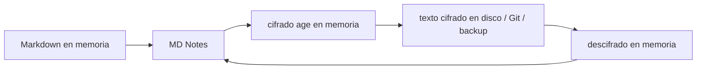

# Almacén cifrado — funcionamiento, claves y límites de protección

[🇺🇦 Українська](ENCRYPTED_VAULT.uk.md) · [🇬🇧 English](ENCRYPTED_VAULT.en.md) · [🇫🇷 Français](ENCRYPTED_VAULT.fr.md) · [🇩🇪 Deutsch](ENCRYPTED_VAULT.de.md) · **🇪🇸 Español** · [🇰🇷 한국어](ENCRYPTED_VAULT.ko.md) · [🇯🇵 日本語](ENCRYPTED_VAULT.ja.md)

> Válido para MD Notes v1.0.0. El ucraniano es el texto canónico. Este documento describe el comportamiento real del producto, no solo la intención de ADR-0007.

## 1. Propósito

Un vault normal contiene Markdown abierto. El **almacén cifrado** opcional protege copias que pueden terminar en un disco externo, Git, una carpeta sincronizada en la nube, una copia de seguridad o un dispositivo perdido.

Usa el formato abierto **age** y claves X25519. MD Notes no inventa criptografía propia.

## 2. Principio

La aplicación trabaja lógicamente con `projects/secret-note.md`, pero cifra los bytes en memoria antes de escribirlos en el almacenamiento físico.

El proveedor de almacenamiento inferior no debe recibir texto plano de notas o adjuntos.

## 3. Nombres aleatorios en vault nuevos

Los nuevos vault de v1.0.0 usan **random names**, por ejemplo `k8r2p6m1q4x7z9ab.age`. La ruta lógica queda dentro del contenedor cifrado.

Esto oculta nombres de notas y carpetas frente al sistema de archivos y Git. Los vault antiguos pueden seguir en modo `named`, donde los nombres son visibles aunque el contenido esté cifrado.

Aun con nombres aleatorios siguen siendo observables el número aproximado de archivos, sus tamaños, fechas de modificación y metadatos de servicio abiertos.

## 4. Qué se cifra

Los archivos ordinarios y `.mdnotes/trash/` se cifran. El resto de `.mdnotes/` es, en general, metadato de servicio abierto.

`.mdnotes/encryption.json` no es secreto: contiene formato/versión, `vaultId`, destinatarios públicos `age1...` y el modo de nombres. No contiene clave privada.

## 5. Clave privada

Una clave privada tiene aspecto `AGE-SECRET-KEY-...`.

Nunca debe guardarse en el vault, `localStorage`, Git, registros o el ZIP de backup.

MD Notes la guarda en el almacén de secretos del sistema operativo: Windows Credential Manager, macOS Keychain o Linux Secret Service.

Al crear el vault el usuario debe conservar una copia de recuperación independiente. Si se pierden todas las claves privadas/recovery utilizables, el contenido cifrado no puede recuperarse.

## 6. Otro dispositivo

Copie o restaure el vault, ábralo y, si el nuevo dispositivo no tiene la clave, importe `AGE-SECRET-KEY-...` por separado. Después quedará en el secret store del sistema.

No transporte vault y clave privada por el mismo canal si busca protección independiente.

## 7. Destinatario de recuperación

age puede cifrar para varios destinatarios públicos. Modelo recomendado: clave de trabajo en el secret store, clave privada de recovery separada y preferiblemente offline, solo claves públicas en el vault.

En la estabilización 1.0, una bóveda cifrada **ya creada** puede añadir un destinatario de recuperación desde **Archivo → «Gestionar clave de recuperación…»**. Pegue únicamente la clave pública `age1…`; MD Notes vuelve a cifrar los archivos para todos los destinatarios. La clave privada de recuperación permanece fuera de la bóveda.

## 8. Caché/índice

`.mdnotes/cache/index.db` sigue siendo una caché local abierta y puede contener datos derivados en texto plano para búsqueda y grafo.

No se sincroniza, no se envía a Git y el backup integrado la excluye. Su protección depende de la cuenta del sistema y del cifrado del disco.

Por ello “encrypted vault” no equivale a cifrar cada byte de MD Notes.

## 9. Adjuntos e imágenes

En la estabilización 1.0, las imágenes y PDF de una bóveda cifrada se leen mediante el proveedor de almacenamiento activo, se descifran **solo en memoria** y se muestran mediante URL Blob en memoria. No se escribe ningún archivo temporal en texto plano en el disco.

La acción externa **«Abrir archivo»** está desactivada intencionadamente para adjuntos cifrados, porque entregarlos a otra aplicación exigiría una copia en texto plano en el disco. Los demás tipos de adjuntos siguen almacenados correctamente cifrados aunque no tengan vista previa integrada.

## 10. Git

Un guard debe impedir el push de texto plano. Los nuevos vault con nombres aleatorios muestran a Git archivos `*.age` aleatorios; los antiguos `named` pueden revelar rutas.

Git no guarda la clave privada.

## 11. Backup

El backup integrado copia el estado físico; para un vault cifrado eso significa texto cifrado. Excluye `.git`, `.mdnotes/cache`, clave privada y clave privada recovery.

El archivo y una clave utilizable son **dos componentes independientes** de recuperación. Véase [Backup y recuperación](BACKUP_AND_RECOVERY.es.md).

## 12. Qué protege

Una copia del vault sin clave — ZIP robado, copia Git, carpeta sincronizada o medio separado — permanece ilegible.

## 13. Qué NO protege

No protege frente a malware bajo una cuenta ya desbloqueada, compromiso del secret store, captura de pantalla, pérdida de todas las claves, datos abiertos en la caché local o análisis de tamaño/número/fechas de archivos.

Para datos sensibles, combinar con BitLocker/FileVault/LUKS y bloqueo normal de cuenta.

## 14. Procedimiento seguro

**Creación**: entorno fiable → guardar la clave por separado → probar reapertura → primer backup.

**Migración**: copiar vault sin la clave → instalar MD Notes → abrir → importar la clave por otro canal → comprobar varias notas y el grafo.

**Pérdida del dispositivo**: restaurar el cifrado desde backup/Git/sync y la clave por separado. MD Notes no tiene una “clave maestra”.

## 15. Automatización e IA

Reglas normativas:
- [ENCRYPTED_VAULT_CONTRACT.md](../ai/ENCRYPTED_VAULT_CONTRACT.md);
- [encrypted-vault-contract.yaml](../ai/encrypted-vault-contract.yaml).

Una IA no debe colocar una clave privada en vault/Git/logs, crear copias persistentes descifradas, afirmar que la caché está cifrada ni prometer recuperar claves perdidas.

> Traducción generada automáticamente y no revisada por un hablante nativo; el ucraniano es canónico.
