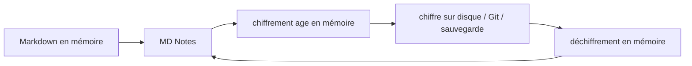

# Coffre chiffré — fonctionnement, clés et limites de protection

[🇺🇦 Українська](ENCRYPTED_VAULT.uk.md) · [🇬🇧 English](ENCRYPTED_VAULT.en.md) · **🇫🇷 Français** · [🇩🇪 Deutsch](ENCRYPTED_VAULT.de.md) · [🇪🇸 Español](ENCRYPTED_VAULT.es.md) · [🇰🇷 한국어](ENCRYPTED_VAULT.ko.md) · [🇯🇵 日本語](ENCRYPTED_VAULT.ja.md)

> Valable pour MD Notes v0.3.23. L’ukrainien est canonique. Ce texte décrit le comportement réel, pas seulement l’intention d’ADR-0007.

## 1. But

Un coffre normal contient des fichiers Markdown ouverts. Le **coffre chiffré** optionnel protège une copie placée sur un support externe, dans Git, un dossier cloud synchronisé, une sauvegarde ou un appareil perdu.

Il utilise le format ouvert **age** et des clés X25519. MD Notes n’invente pas sa propre cryptographie.

## 2. Principe

L’application travaille logiquement avec `projects/secret-note.md`, puis chiffre les octets en mémoire avant l’écriture physique.

Le fournisseur de stockage sous-jacent ne doit pas recevoir le texte clair des notes ou pièces jointes.

## 3. Noms aléatoires dans les nouveaux coffres

Les nouveaux coffres v0.3.23 utilisent des **noms aléatoires**, par exemple `k8r2p6m1q4x7z9ab.age`. Le chemin logique est stocké dans l’enveloppe chiffrée.

Cela masque les noms de notes et de dossiers au système de fichiers et à Git. Les anciens coffres peuvent rester en mode `named`, où les noms sont visibles mais le contenu est chiffré.

Le mode aléatoire ne masque pas le nombre approximatif de fichiers, leur taille, leurs dates ni les métadonnées de service ouvertes.

## 4. Ce qui est chiffré

Les fichiers ordinaires et `.mdnotes/trash/` sont chiffrés. Le reste de `.mdnotes/` est généralement une métadonnée de service ouverte.

`.mdnotes/encryption.json` n’est pas secret : format/version, `vaultId`, destinataires publics `age1...` et mode de noms. Aucune clé privée n’y est stockée.

## 5. Clé privée

Une clé privée ressemble à `AGE-SECRET-KEY-...`.

Elle ne doit jamais être stockée dans le coffre, `localStorage`, Git, les logs ou l’archive de sauvegarde.

MD Notes la conserve dans le gestionnaire de secrets du système : Windows Credential Manager, macOS Keychain ou Linux Secret Service.

À la création, l’utilisateur doit conserver une copie de récupération indépendante. La perte de toutes les clés utilisables rend les données irrécupérables.

## 6. Autre appareil

Copiez/restaurez le coffre, ouvrez-le, puis importez séparément `AGE-SECRET-KEY-...` si le nouvel appareil ne possède pas la clé. Elle sera ensuite conservée dans le secret store de cet appareil.

Évitez de transporter coffre et clé privée par le même canal.

## 7. Destinataire de récupération

age peut chiffrer pour plusieurs clés publiques. Modèle recommandé : clé de travail dans le secret store, clé privée de récupération séparée hors ligne, seulement les clés publiques dans le coffre.

Dans la stabilisation 1.0, un coffre chiffré **déjà créé** peut recevoir un destinataire de récupération via **Fichier → « Gérer la clé de récupération… »**. Collez uniquement la clé publique `age1…` ; MD Notes rechiffre les fichiers pour tous les destinataires. La clé privée de récupération reste hors du coffre.

## 8. Cache/index

`.mdnotes/cache/index.db` reste un cache local ouvert et peut contenir des données dérivées en clair pour la recherche et le graphe.

Il n’est pas synchronisé, pas envoyé dans Git et n’entre pas dans la sauvegarde intégrée. Sa protection dépend du compte OS et du chiffrement du disque.

Le coffre chiffré n’est donc pas un chiffrement intégral de tous les octets MD Notes.

## 9. Pièces jointes

Dans la stabilisation 1.0, les images et PDF d’un coffre chiffré sont lus via le fournisseur de stockage actif, déchiffrés **uniquement en mémoire** et affichés par des URL Blob en mémoire. Aucun fichier temporaire en clair n’est écrit sur le disque.

L’action externe **« Ouvrir le fichier »** est volontairement désactivée pour les pièces jointes chiffrées, car la remise du fichier à une autre application nécessiterait une copie en clair sur le disque. Les autres types de pièces jointes restent correctement chiffrés même sans aperçu intégré.

## 10. Git

Un garde-fou doit empêcher le push de texte clair. Les nouveaux coffres à noms aléatoires exposent à Git des `*.age` aléatoires ; les anciens `named` peuvent exposer les noms de chemins.

Git ne sauvegarde pas la clé privée.

## 11. Sauvegarde

La sauvegarde intégrée copie l’état physique : donc le chiffre pour un coffre encrypted. Elle exclut `.git`, `.mdnotes/cache`, la clé privée et la clé privée de récupération.

Conservez l’archive et une clé de récupération comme **deux composants indépendants**. Voir [Sauvegarde et récupération](BACKUP_AND_RECOVERY.fr.md).

## 12. Menaces couvertes

Une copie du coffre sans clé — ZIP volé, dépôt Git, dossier synchronisé ou support séparé — reste illisible.

## 13. Menaces non couvertes

Pas de protection attendue contre malware sous un compte déjà déverrouillé, compromission du secret store, capture d’écran, perte de toutes les clés, fuite du cache local ou analyse taille/nombre/date des fichiers.

Pour les données sensibles, combinez avec BitLocker/FileVault/LUKS et le verrouillage du compte.

## 14. Procédure sûre

**Création** : environnement fiable → sauvegarde séparée de la clé → test de réouverture → première sauvegarde.

**Migration** : copier le coffre sans la clé → installer MD Notes → ouvrir → importer la clé par un autre canal → vérifier plusieurs notes et le graphe.

**Perte d’appareil** : restaurer le chiffre depuis backup/Git/sync et restaurer séparément la clé. MD Notes ne possède aucun « master key ».

## 15. Automatisation et IA

Règles normatives :
- [ENCRYPTED_VAULT_CONTRACT.md](../ai/ENCRYPTED_VAULT_CONTRACT.md) ;
- [encrypted-vault-contract.yaml](../ai/encrypted-vault-contract.yaml).

Une IA ne doit jamais placer une clé privée dans le coffre/Git/logs, créer des copies déchiffrées persistantes, prétendre que le cache est chiffré ou promettre la récupération d’une clé perdue.

> Traduction automatique, non relue par un locuteur natif ; l’ukrainien est canonique.
