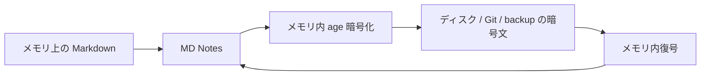

# 暗号化 Vault — 仕組み、鍵、保護範囲

[🇺🇦 Українська](ENCRYPTED_VAULT.uk.md) · [🇬🇧 English](ENCRYPTED_VAULT.en.md) · [🇫🇷 Français](ENCRYPTED_VAULT.fr.md) · [🇩🇪 Deutsch](ENCRYPTED_VAULT.de.md) · [🇪🇸 Español](ENCRYPTED_VAULT.es.md) · [🇰🇷 한국어](ENCRYPTED_VAULT.ko.md) · **🇯🇵 日本語**

> MD Notes v0.3.23 を対象とします。ウクライナ語版が正本です。ADR-0007 の設計意図だけでなく、実際の製品動作を説明します。

## 1. 目的

通常の vault は開かれた Markdown ファイルです。オプションの **暗号化 vault** は、外付けディスク、Git、同期クラウドフォルダー、バックアップ、紛失端末などに vault のコピーが存在する場合に内容を守るためのものです。

公開仕様の **age** と X25519 鍵を使用し、MD Notes 独自の暗号方式は作りません。

## 2. 基本原則

アプリは論理的には `projects/secret-note.md` を扱いますが、物理ストレージへ書く前にメモリ内で暗号化します。

下位 storage provider にノートや添付ファイルの平文を渡してはいけません。

## 3. 新しい vault のランダム名

v0.3.23 で新規作成する暗号化 vault は **random names** を使います。物理ファイルは `k8r2p6m1q4x7z9ab.age` のようになり、論理パスは暗号化 envelope 内に入ります。

そのため新規 vault ではファイルシステムや Git からノート名・フォルダー名を隠せます。以前の vault は `named` モードのままの場合があり、その場合は名前が見えて内容だけが暗号化されます。

ランダム名でも、ファイル数、おおよそのサイズ、更新時刻、開かれたサービスメタデータは隠しません。

## 4. 暗号化されるもの

通常の vault ファイルと `.mdnotes/trash/` は暗号化されます。その他の `.mdnotes/` は原則として開かれたサービスメタデータです。

`.mdnotes/encryption.json` は秘密情報ではありません。format/version、`vaultId`、公開 recipient `age1...`、名前レイアウトを含みますが、秘密鍵は含みません。

## 5. 秘密鍵

秘密鍵は `AGE-SECRET-KEY-...` の形式です。

vault、`localStorage`、Git、ログ、vault backup ZIP に保存してはいけません。

MD Notes は Windows Credential Manager、macOS Keychain、Linux Secret Service など OS の secret store に保存します。

新規作成時、利用者は独立した復旧用コピーを保管する必要があります。使用可能な秘密鍵/recovery key をすべて失うと暗号文は復旧できません。

## 6. 別端末で開く

vault をコピーまたは復元し、開きます。新端末に鍵がなければ `AGE-SECRET-KEY-...` を別経路でインポートし、OS secret store に保存します。

独立した保護を求めるなら、vault と秘密鍵を同じ経路で運ばないでください。

## 7. Recovery recipient

age は複数の公開 recipient に暗号化できます。推奨: 作業用秘密鍵は端末 secret store、recovery 秘密鍵は別途/オフライン、vault には公開鍵のみ。

v0.3.23 の制限: **既に作成した** vault に recovery key を追加する UI は未完成です。

## 8. キャッシュ/インデックス境界

`.mdnotes/cache/index.db` は暗号化 vault でも開かれたローカルキャッシュです。検索やグラフのための派生平文データを含む可能性があります。

同期されず、Git に入らず、内蔵 backup にも含まれません。保護は OS アカウントとディスク暗号化に依存します。

したがって “encrypted vault” は MD Notes の全バイトを完全暗号化する意味ではありません。

## 9. 添付ファイルと画像

storage 層は任意のバイトを暗号化できますが、**v0.3.23 では暗号化 vault 内の画像/添付ファイル表示に既知の UI ギャップがあります**。この利用フローを完成済みと説明してはいけません。

## 10. Git

暗号化 vault の Git push には平文送信を防ぐ guard があります。新しい random-name vault は Git にランダムな `*.age` を見せ、古い `named` vault ではパス名が見える場合があります。

Git は秘密鍵のバックアップではありません。

## 11. Backup

内蔵 backup は物理ディスク状態をコピーするため、暗号化 vault では暗号文をコピーします。`.git`、`.mdnotes/cache`、秘密鍵、recovery 秘密鍵は含みません。

backup と利用可能な復旧鍵は **独立した2要素**として保管してください。[Backup と復旧](BACKUP_AND_RECOVERY.ja.md)を参照してください。

## 12. 守れるもの

鍵のない vault コピー — 盗難 ZIP、Git コピー、同期フォルダー、別媒体 — の内容を読めない状態にします。

## 13. 守れないもの

既にロック解除された OS アカウントで動くマルウェア、secret store の侵害、画面キャプチャ、全鍵の紛失、ローカル cache の派生平文、ファイル数/サイズ/時刻の分析は防げません。

機密データでは BitLocker/FileVault/LUKS などディスク暗号化も併用してください。

## 14. 安全な手順

**作成**: 信頼できる環境 → 鍵を別途保存 → 再オープン試験 → 最初の backup。

**移行**: 鍵なしで vault をコピー → 新端末に MD Notes → vault を開く → 別経路で鍵をインポート → 複数ノートとグラフを確認。

**端末紛失**: backup/Git/sync から暗号文を戻し、鍵は別途復旧します。MD Notes に age を回避する master key はありません。

## 15. 自動化と AI

規範ルール:
- [ENCRYPTED_VAULT_CONTRACT.md](../ai/ENCRYPTED_VAULT_CONTRACT.md)
- [encrypted-vault-contract.yaml](../ai/encrypted-vault-contract.yaml)

AI は秘密鍵を vault/Git/log に書いたり、利便性のために永続平文コピーを作ったり、cache が暗号化済みと主張したり、失った鍵を MD Notes が復旧できると約束してはいけません。

> 自動生成翻訳であり、ネイティブ校閲は未実施です。ウクライナ語版が正本です。
