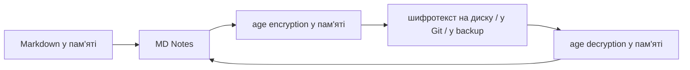

# Зашифроване сховище — принцип роботи, ключі та межі захисту

**🇺🇦 Українська** · [🇬🇧 English](ENCRYPTED_VAULT.en.md) · [🇫🇷 Français](ENCRYPTED_VAULT.fr.md) · [🇩🇪 Deutsch](ENCRYPTED_VAULT.de.md) · [🇪🇸 Español](ENCRYPTED_VAULT.es.md) · [🇰🇷 한국어](ENCRYPTED_VAULT.ko.md) · [🇯🇵 日本語](ENCRYPTED_VAULT.ja.md)

> Актуально для MD Notes v1.0.0. Канонічна версія — українська. Цей документ описує фактичну поведінку продукту, а не лише задум ADR-0007.

## 1. Навіщо це потрібно

Звичайне сховище MD Notes — це відкриті Markdown-файли. Це зручно й прозоро, але копія такої папки читається будь-яким файловим менеджером.

Опціональне **зашифроване сховище** призначене для випадків, коли копія папки може опинитися:
- на зовнішньому диску;
- у Git;
- у синхронізованій хмарній папці;
- у резервній копії;
- на втраченому або вилученому носії.

Зашифроване сховище використовує відкритий формат **age** і X25519-ключі. MD Notes не створює власну криптографію.

## 2. Головний принцип

Логічно застосунок працює з файлом:

```text
projects/secret-note.md
```

але перед записом у фізичне сховище дані шифруються в пам’яті.



Нижчий storage provider не повинен отримувати відкритий текст нотатки або вкладення.

## 3. Як виглядає нове зашифроване сховище v1.0.0

Нові зашифровані vault створюються з режимом **random names**.

Замість читабельного `projects/secret-note.md.age` фізичний файл отримує випадкове ім’я на кшталт:

```text
k8r2p6m1q4x7z9ab.age
```

Логічний шлях `projects/secret-note.md` зберігається **всередині зашифрованого контейнера**, а не в імені файла.

Це приховує від файлової системи й Git назви нотаток та структуру папок для нових vault. Старі vault, створені до появи random-name layout, можуть лишатися в режимі `named`, де назви/папки видно, а вміст зашифрований.

Навіть у random-name режимі зовнішній спостерігач все ще може бачити:
- факт існування файлів;
- приблизну кількість;
- розміри шифротекстів;
- час зміни;
- службові відкриті файли, описані нижче.

## 4. Що саме шифрується

`EncryptedProvider` шифрує звичайні файли vault до передачі нижчому сховищу. Кошик `.mdnotes/trash/` також зберігає зашифровані дані.

Службова папка `.mdnotes/` загалом є **відкритою**, крім кошика. Вона може містити конфігурацію, schema, templates/views та файл параметрів шифрування.

Особливо важливо: `.mdnotes/encryption.json` не є секретом. Він містить лише параметри й **публічні** ключі одержувачів, наприклад:
- format/version;
- `vaultId`;
- список `recipients` (`age1...`);
- режим імен `random` або старий `named`.

Приватного ключа в цьому файлі немає.

## 5. Де зберігається приватний ключ

Приватний age-ключ має вигляд приблизно:

```text
AGE-SECRET-KEY-...
```

Він **не повинен** зберігатися:
- у файлах vault;
- у `localStorage`;
- у Git;
- у логах;
- у резервному ZIP разом зі сховищем.

На робочому пристрої MD Notes зберігає ключ у системному сховищі секретів ОС:
- Windows Credential Manager;
- macOS Keychain;
- Linux Secret Service.

При створенні нового зашифрованого vault ключ показується користувачу для резервного збереження. Це критичний момент: якщо втрачено всі приватні ключі/ключ відновлення, дані криптографічно недоступні.

## 6. Відкриття на іншому пристрої

Сценарій:
1. ви скопіювали або відновили зашифрований vault;
2. новий пристрій бачить `.mdnotes/encryption.json`, розуміє, що vault encrypted;
3. у системному сховищі секретів цього пристрою ще немає відповідного приватного ключа;
4. MD Notes просить імпортувати `AGE-SECRET-KEY-...`;
5. після успішного імпорту ключ зберігається в secret store цього пристрою;
6. надалі відкриття відбувається без повторного введення, доки ключ доступний обліковому запису ОС.

Не передавайте приватний ключ разом із самим vault тим самим каналом, якщо прагнете незалежного захисту.

## 7. Recovery recipient

age дозволяє шифрувати файл одразу для кількох публічних одержувачів. Тому при створенні vault можна мати робочий ключ і окремий **recovery public key**.

Практичне правило:
- робочий приватний ключ — у secret store пристрою;
- recovery private key — окремо, бажано офлайн;
- у vault зберігаються лише публічні `age1...` recipients.

У стабілізації 1.0 recovery recipient можна додати і до **вже створеного** encrypted vault через меню **Файл → «Керувати ключем відновлення…»**. Вставляється лише публічний ключ `age1…`; MD Notes повторно шифрує файли для всіх recipients. Приватний recovery key лишається поза vault.

## 8. Кеш та індекс — важлива межа

У зашифрованому vault `.mdnotes/cache/index.db` лишається локальним відкритим кешем.

Це означає, що він може містити похідні відкриті дані, потрібні для пошуку/графа: заголовки, посилання та іншу індексовану інформацію.

Захист кешу в поточному MVP покладається на:
- те, що cache не синхронізується;
- те, що cache не йде в Git;
- шифрування диска та захист облікового запису ОС.

Тому «encrypted vault» у v1.0.0 не слід описувати як абсолютне повнодискове шифрування всіх байтів MD Notes.

Резервна копія MD Notes `.mdnotes/cache` не включає.

## 9. Вкладення та зображення

У стабілізації 1.0 зображення й PDF у encrypted vault читаються через активний storage provider, розшифровуються **лише в пам’яті** й показуються через in-memory Blob URL. Plaintext temp-файл на диск не створюється.

Зовнішня команда **«Відкрити файл»** для encrypted attachment навмисно вимкнена: передача такого файла іншій програмі вимагала б створити відкриту копію на диску. Інші типи вкладень лишаються коректно зашифрованими у vault, навіть якщо для них немає inline preview.

## 10. Git та зовнішня синхронізація

Для encrypted vault Git push проходить через запобіжник, який не повинен відправляти відкритий текст.

Для нових random-name vault Git бачить випадкові `*.age` файли, а не логічні назви нотаток. Для старих `named` vault назви шляхів можуть бути видимі.

Git не є резервною копією приватного ключа. Наявність усіх `*.age` файлів без ключа не дає доступу до тексту.

## 11. Backup encrypted vault

Вбудований backup копіює **фізичний стан на диску**. Для encrypted vault це означає шифротекст.

У backup:
- входять encrypted files і відкриті службові файли, крім виключень;
- не входить `.git`;
- не входить `.mdnotes/cache`;
- не входить приватний ключ;
- не входить recovery private key.

Тому ZIP зашифрованого vault і ключ потрібно зберігати як **два незалежні компоненти відновлення**.

Докладніше: [Backup і відновлення](BACKUP_AND_RECOVERY.uk.md).

## 12. Від чого це захищає

Encrypted vault добре захищає від читання **самої копії сховища без ключа**:
- викрадений ZIP;
- копія Git;
- копія синхронізованої папки;
- окремий диск із файлами vault.

## 13. Від чого це НЕ захищає

Не слід очікувати захисту від:
- шкідливої програми, яка вже працює під вашим розблокованим обліковим записом;
- компрометації системного secret store;
- знімка екрана або читання тексту, коли нотатка вже відкрита;
- втрати всіх ключів;
- витоку даних із відкритого `.mdnotes/cache` на тому ж диску;
- аналізу розміру/кількості/часу зміни файлів.

Для чутливих даних encrypted vault варто поєднувати з BitLocker/FileVault/LUKS або іншим шифруванням диска та блокуванням облікового запису.

## 14. Безпечна процедура користувача

### Створення
1. Створіть encrypted vault лише в довіреному середовищі.
2. Збережіть показаний приватний/recovery ключ окремо.
3. Переконайтесь, що резервна копія ключа читається й не зберігається тільки на тому самому диску.
4. Створіть тестову нотатку, закрийте й відкрийте vault.
5. Зробіть перший backup.

### Перенесення
1. Скопіюйте vault/backup без приватного ключа.
2. На новому пристрої встановіть MD Notes.
3. Відкрийте vault.
4. Імпортуйте приватний ключ окремим каналом.
5. Перевірте кілька нотаток і граф.
6. Лише після цього вважайте міграцію завершеною.

### Втрата пристрою
1. Не покладайтеся лише на копію vault.
2. Відновіть дані з backup/Git/синхронізованої копії.
3. Відновіть доступ окремо з recovery/private key.
4. Якщо ключів немає — MD Notes не має «майстер-ключа» і не може обійти age.

## 15. Для автоматизації та ШІ

Нормативні правила винесені окремо:
- [ENCRYPTED_VAULT_CONTRACT.md](../ai/ENCRYPTED_VAULT_CONTRACT.md);
- [encrypted-vault-contract.yaml](../ai/encrypted-vault-contract.yaml).

ШІ або автоматичний редактор **не має права**:
- записувати приватний ключ у vault/Git/log;
- розшифровувати vault «для зручності» в постійну тимчасову папку;
- стверджувати, що cache зашифрований;
- стверджувати, що втрачені ключі можна відновити сервісом MD Notes.
