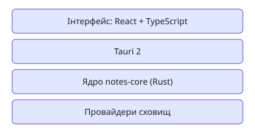

# MD Notes

Кросплатформний застосунок для бази знань у Markdown. Принципи —
[[Local-first]] і відкриті файли.



## Задачі

```query
type: task
where: project = [[MD Notes]]
sort: due asc
view: table
columns: [title, status, due, priority]
```

У stable v1.0.0 мова запитів із прикладу вище ще не реалізована, тому нижче — звичайний список:

- [x] [[Дерево файлів]]
- [x] [[Граф знань]]
- [ ] [[Мобільна версія]] — build smoke є; фізичне приймання пристроїв post-1.0

## Люди

- [[Олена Коваль]] — дизайн інтерфейсу

#mdnotes
